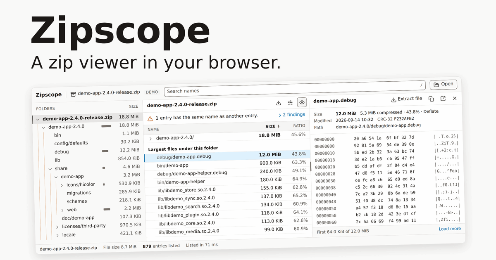

Zipscope is a zip inspector that runs in your browser. Drop a large archive (a build artifact, a dataset dump, or a jar, apk, whl, vsix or docx file) and Zipscope lists its contents as it reads the central directory. You can then examine the archive with a folder tree that shows the size of each folder, a sortable table, search, a health summary, preview and extraction. All work occurs on your device. The file does not leave your computer, and you do not install anything.

Open Zipscope at [zip.nickb.dev](https://zip.nickb.dev).
